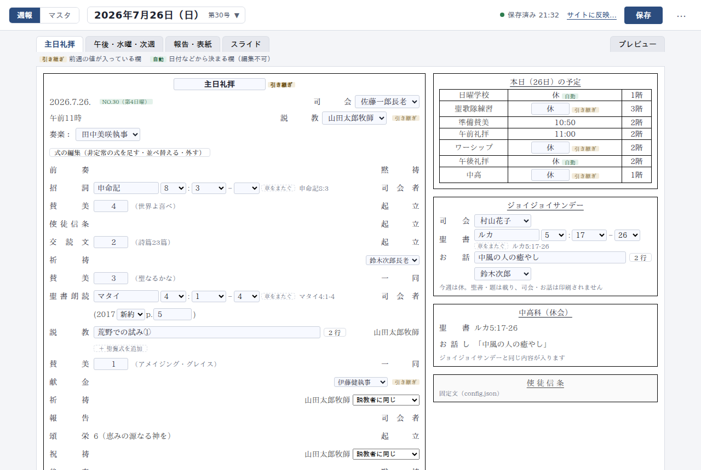
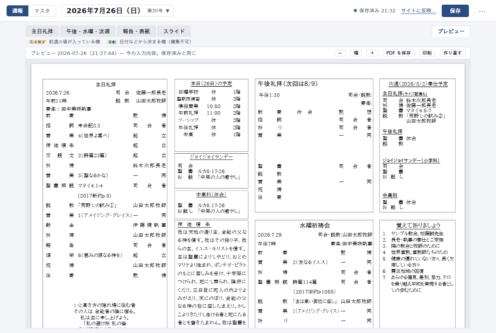
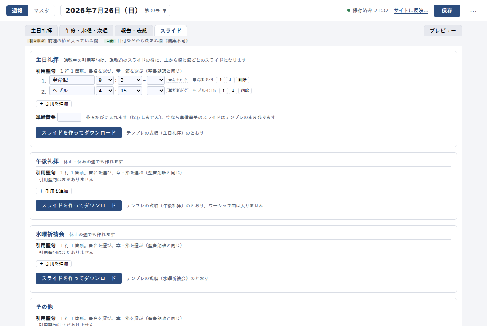
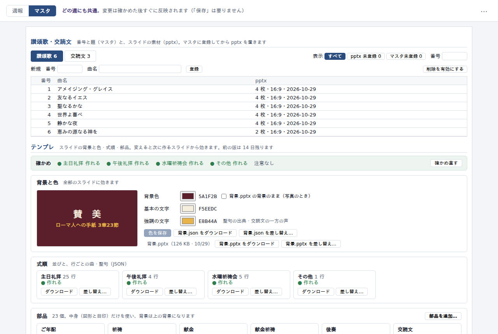

# church-bulletin-generator

小さな教会の **週報（毎週の印刷物）と礼拝スライド** を、ブラウザの入力画面から作るシステムです。
それまで牧師が毎週 Word で手作りしていた週報（A4 横・両面）を、入力画面に打ち込むだけで、原本と同じ紙面の PDF が出るようにしました。礼拝で映すスライド（pptx）と、ホームページの礼拝案内も同じデータから作ります。

要件定義・設計の判断・実機での検証を自分で行い、実装には AI のコーディング支援（Claude Code）を使いました。実際の教会で試験運用しているシステムを、公開用に教会名・アカウントの ID・URL などを架空の値に置き換えて写したものです（運用データは含みません）。

| 入力画面 | プレビュー（サーバーで作った PDF） |
|---|---|
|  |  |
| **スライドの生成** | **歌詞・交読文・テンプレートの管理** |
|  |  |

## 背景と課題

- 週報は牧師が毎週 Word のファイルを上書きして作っていて、司会者や説教題といったデータが Word の中にしかなかった
- スライドを作るときは同じ内容を Excel に打ち直し、ホームページの礼拝案内もまた別に手で書き換えていた（同じ内容を 3 回入力）
- 過去 13 週の週報を調べると、4 週に手作業が原因の崩れ（式順の行のずれ 3 件、はみ出しによる白紙のページ 1 件）があった

これを「Word のテンプレートを直す」問題ではなく、**「データを Word から取り出す」問題**と定義しました。入力したデータを 1 か所（正本）に置き、印刷用の PDF・投影用の pptx・ホームページの案内の 3 つを、すべてそこから機械的に作ります。制約は「予算ゼロ・IT 担当ゼロ・個人情報あり・利用者は iPad も使う」です。

## 何ができるか

- **週報の入力と PDF 化**：司会・説教題・賛美の番号・報告などを入力すると、サーバーで PDF を組み、画面にそのまま表示する。プレビューと印刷物が同じ PDF なので「画面と紙が違う」が起きない
- **前の週からの引き継ぎ**：新しい週は、前の週の「次週の予定」欄から担当者・聖書箇所・説教題を自動で入れる。休会の暦（第何週は休み、など）も自動で反映
- **礼拝スライド（pptx）の生成**：賛美の番号から歌詞、聖書箇所から本文を引いて、背景・部品・式順のテンプレートに流し込む
- **役割ごとの入口**：週報を書く牧師と、スライドを担当する人で、触れる範囲を分けている（スライド担当は週報の中身を変えられない）
- **教会サイトへの反映**：ボタン 1 つで、ホームページの礼拝案内を最新の週に作り直す

## 構成

```
 牧師のブラウザ（入力画面）                  スライド担当のブラウザ
        │  Cloudflare Access（メールのワンタイム PIN）   │  Cloudflare Access（別の名簿）
        ▼                                                ▼
 Cloudflare Worker（週報）  ◀──── Service Binding ──── Cloudflare Worker（スライド担当用。データを持たない）
   ├─ API の門番（Access の JWT を検証。無ければ 403）
   ├─ D1   … 週データ・名簿・変更の記録・ファイルの目次
   ├─ D1   … 聖書本文（読み取り専用）
   ├─ KV   … 歌詞・テンプレートの中身（内容のハッシュ名）、PDF のキャッシュ
   └─ PDF エンジン … Render 上のコンテナ（Chromium）⇄ Cloudflare Browser Rendering を設定で切り替え
```

## 使った技術

| 分野 | 技術 |
|---|---|
| 実行環境 | Cloudflare Workers、D1（SQLite）、KV、Service Binding、Workers Builds、Cron Triggers |
| 認証 | Cloudflare Access（Worker 単位）＋ アプリ側での JWT 検証 |
| PDF | HTML/CSS のテンプレートを Chromium（Playwright / Puppeteer）で PDF 化。Render（Docker）と Browser Rendering の 2 系統 |
| 画面 | 素の JavaScript（ES Modules）。PDF.js で PDF を表示 |
| スライド | pptx（Office Open XML）を JSZip で組み立て（ブラウザ内でも生成） |
| テスト | Node.js 組み込みのテストランナー（97 件。Chromium で実際に紙面を組んで寸法を測る試験を含む） |
| データ整備 | Python（聖書本文・讃美歌・交読文の取り込み） |

## 工夫したところ

**1. 費用が「絶対に発生しない」作りにした**
教会に毎月の請求を確かめる担当はいません。そこで、どのサービスにもクレジットカードを登録しないことを原則にしました。Cloudflare と Render の無料枠だけで動かし、上限に当たったときは「止まる」で済んで「請求される」は起こらない構成です。カード登録が必要な R2 は使わず、D1 と KV で置き換えました。PDF エンジンは、無料枠を使い切ったときに備えて 2 系統を設定で切り替えられるようにしています。

**2. Word の原本と同じ紙面を HTML/CSS で再現した**
過去 14 部の原本と行ごとに比べて、欄ごとの字間や改行位置を合わせました。文字が欄に入らないときは、横幅 → 字間 → 文字サイズの順に縮める規則（`src/template/fit-policy.json`）を当てます。それでも入らない欄は PDF 上で赤枠にし、画面に「どの欄を・どう直せばよいか」を出します。

**3. 同じ入力からは PDF を作り直さない**
PDF の元になるデータ・フォント・テンプレートの版・Chromium の版からハッシュ（指紋）を作り、KV にキャッシュしています。曲名を 1 つ直しても、その曲を使う週だけが作り直しになります。無料枠の節約と、プレビューの速さのための仕組みです。

**4. 認証が外れたら「誰も入れない」側に倒れるようにした**
Cloudflare Access の手前の設定を誤っても個人情報が漏れないよう、Worker の中でも Access の証明（JWT）を検証し、無ければ API を断ります。画面の HTML・JS・CSS は門番を通らずに配信されるため、そこには一切データを入れません。これはビルド後の成果物を検査するテスト（`tests/assets-no-data.test.mjs`）で守っています。

**5. 権限を Worker の単位で分けた**
スライド担当用の入口は別の Worker にし、データを持たせていません。週報の Worker とは Service Binding でつなぎ、許可した操作（歌詞の差し替え、スライドの生成など）だけを受け付ける窓口クラスを置いています。担当者に何ができるかは、その許可の一覧そのものです。

**6. ファイルは上書きせず、版を残す**
歌詞やテンプレートのファイルは、内容のハッシュを名前にして KV に置き、「今の版」の目次だけを D1 に持ちます。差し替えても前の版は 14 日残り、毎朝 Cron で片付けます。誤って差し替えても戻せます。

**7. 実機で起きた問題を記録して設計に戻した**
iPad の Safari では、ダウンロードの確認が出ている間にページの通信が落ちる、PDF を iframe で 1 ページしか描かない、といった問題が実際に起きました。保存とダウンロードを分ける、PDF.js の Web Worker を使い回して表示を通信なしで終える、などで対処しています。経緯と原因は設計書に残しています。

**8. データの置き場を「誰が変えるか」で分けた**
開発者がエディタで変えるもの（コード・紙面のテンプレート・設定・仮名の見本）は Git に、牧師や担当者が画面から変えるもの（週データ・名簿・曲名・スライドの素材）は D1・KV に置く、という基準で線を引きました。手元の開発サーバと本番の Worker は同じ API のコードを使い、差し替えるのは保存先だけです。そのため、見本一式（`data/examples/`）を入れれば、本番のデータが無くても clone した手元で全機能を試せます。

## 数字で見ると

| 項目 | 数 |
|---|---|
| 開発期間 | 約 6 週間（要件定義から、2 種類の利用者の画面・4 種類のスライド・ホームページへの反映まで） |
| コミット | 186（非公開の開発リポジトリ。このリポジトリは履歴を持たない公開用の写し） |
| 自動テスト | 97 件 |
| 設計書・手順書 | 約 2,500 行 |
| 紙面の再現 | 原本 PDF の 338 行のうち 336 行が、生成した PDF にそのまま出る（残り 2 行は意図した差） |
| PDF の作成時間 | 13.7 秒 → 1.0 秒（同じ入力のときはキャッシュを返す） |
| 月額費用 | 0 円（どのサービスにもカードを登録していない） |

## Cloudflare の設定（認証・権限・トークン）

本番（リハーサル環境）の設定を、Cloudflare の API で読み出して確かめた内容です（2026-10-29 時点）。名前は公開用の写しに合わせて `samplechurch-*` に置き換えています。メールアドレス・ID・トークンの値は載せていません。

### Worker の構成

| Worker | 役割 | バインディング（`wrangler.jsonc`） | シークレット |
|---|---|---|---|
| `samplechurch-shuho` | 牧師の入力画面と API | D1 `DATA`（週・マスタ・記録・ファイルの目次）、D1 `BIBLE`（聖書）、KV `FILES`（素材の中身・PDF のキャッシュ）、Browser Rendering `BROWSER`、静的アセット `ASSETS`、Cron `0 18 * * *`（UTC＝日本時間 3:00。控えの片付け） | `CF_ACCESS_CLIENT_ID` / `CF_ACCESS_CLIENT_SECRET`（サービストークン）、`PDF_RENDER_SECRET`（Render との合言葉）、`SITE_DEPLOY_TOKEN`（サイトの再ビルド用 API トークン） |
| `samplechurch-slides` | スライド担当のページ（データを持たない中継） | Service Binding `SHUHO` → `samplechurch-shuho` の名前付きエントリーポイント `SlidesWindow`、静的アセット | なし |
| `samplechurch` | 教会のホームページ（Astro） | なし（ビルドのときだけ週報の公開 API を読む） | ビルド変数に `CF_ACCESS_CLIENT_ID` / `CF_ACCESS_CLIENT_SECRET` |

3 つとも `workers.dev` のサブドメインとバージョンごとのプレビュー URL が有効です。Workers Logs（observability）は週報と担当者用の 2 つで有効にしています。

### Cloudflare Access（Zero Trust）

Access は **Worker 単位**で掛けています（Workers の設定画面の「Access」。種類は self-hosted）。1 つの Worker の中をパスで分けて別々に保護する設定はカードの登録が要るため使わず、**役割ごとに Worker を分け、Worker ごとに別の名簿を付ける**構成にしました。

- ログインの方法（IdP）: **One-time PIN**（メールに届く暗証番号。利用者に Cloudflare のアカウントは不要）と、Cloudflare のアカウントのメンバー（開発者）
- セッション: アプリごとに **24 時間**（PIN を入れた時から数えて、使っても延びない）。Cookie は HttpOnly
- ポリシーはすべて再利用できる形（reusable）で作り、アプリに付けています

| アプリ（Worker） | ポリシー（評価順） | 動作 | 対象 |
|---|---|---|---|
| `samplechurch-shuho` | Cloudflare account members | Allow | アカウントのメンバー（開発者） |
| | shuho-server-jobs-auth | Service Auth | サービストークン `shuho-server-jobs` |
| | claude-dev-auth | Service Auth | サービストークン `claude-dev` |
| | shuho-editors | Allow | メールの一覧（牧師） |
| `samplechurch-slides` | shuho-slides | Allow | メールの一覧（スライド担当 4 名と牧師） |
| | claude-dev-auth | Service Auth | サービストークン `claude-dev` |
| | Cloudflare account members | Allow | アカウントのメンバー |
| `samplechurch`（サイト） | Cloudflare account members | Allow | アカウントのメンバー |
| | rehearsal-viewers | Allow | メールの一覧（リハーサルの確認者） |
| | claude-dev-auth | Service Auth | サービストークン `claude-dev` |

名簿（ポリシー）は受付どうしで使い回さず、「Everyone」のような誰でも通る条件は書きません（書くと下の門番でも防げないため）。スライド担当の名簿に牧師の画面を開ける人はいない、という形で「週報に印刷される内容を変えられるのは牧師だけ」を作っています。

### サービストークン（機械のための Access の鍵）

| トークン | 使う所 | 渡し方 |
|---|---|---|
| `shuho-server-jobs` | ① PDF エンジン（Chromium）が、紙面の CSS・フォント（`/shuho-assets/`）を Access の内側から読む ② サイトのビルドが、週報の公開用 API を読む | ① Worker のシークレットを、Browser Rendering では `page.setExtraHTTPHeaders`、Render ではリクエストヘッダ `x-page-headers` で渡し、Chromium の全リクエストに `CF-Access-Client-Id` / `CF-Access-Client-Secret` を付ける ② サイトのビルド変数 |
| `claude-dev` | 開発中に AI（Claude Code）がリハーサル環境の診断用 API を読む | 下の「AI に渡す権限」 |

どちらも有効期限なしで発行しています（リハーサルが終わったら `claude-dev` は消す予定）。

### Worker の中での検証（API の門番）

Access の設定を外したり取り違えたりしたときに「誰でも入れる」ではなく「誰も入れない」で止まるよう、Worker の中でも Access の証明を確かめています（`src/lib/auth.mjs` の `accessGate`・`verifyAccessJwt`）。

- ヘッダ `Cf-Access-Jwt-Assertion` の JWT を、`https://<チーム>.cloudflareaccess.com/cdn-cgi/access/certs` の公開鍵（JWKS）で検証する。ライブラリを使わず Web Crypto（`RSASSA-PKCS1-v1_5` / SHA-256）で実装
- 確かめる項目: 署名方式が RS256、署名、`exp`（期限）、`iss`（チームのドメイン）、`aud`（その Worker の Access アプリの AUD。`ACCESS_AUD`）、`email`（人）か `common_name`（サービストークン）があること
- 公開鍵の一覧は 1 時間使い回し、知らない `kid` が来たら取り直す（鍵の入れ替えの直後に断り続けないため）
- 無い・合わない・確かめる値の設定が無い、のどれでも **403**。例外は `api/public/` の GET（サイトのビルドが読む公開してよい情報）と、`localhost` 宛て（手元の開発）だけ
- 静的アセット（HTML・JS・CSS・フォント）は Worker のコードを通らずに配信されるので門番が効かない → **データは `api/` からだけ渡す**決まりにし、ビルドした成果物にデータが入っていないことを `tests/assets-no-data.test.mjs` で確かめる
- スライド担当の Worker は、自分でも同じ検証をして**人（email）の証明だけ**を通す（サービストークンも通さない）。静的アセット付きの Worker には `ctx.access` が渡らないため、ヘッダの JWT を自分で検証している

### Service Binding（Worker 間の内線）と許可リスト

```
担当者のブラウザ ─Access(shuho-slides)→ samplechurch-slides ─Service Binding→ samplechurch-shuho の SlidesWindow
```

- 内線は Access を通らないので、**権限は受け側の窓口 `SlidesWindow`（`WorkerEntrypoint` のクラス）の許可リストそのもの**になる（`src/lib/slides-window.mjs` の `SLIDES_ALLOWED`。メソッドとパスの正規表現の組）
- 許可しているのは、保存済みの週・PDF・素材・テンプレート・聖書を読むことと、歌詞・交読文・テンプレートなどマスタと素材を書くことだけ。**週データを書く操作は一覧に無い**（`tests/slides-window.test.mjs` で確かめる）。禁止リストではなく許可リストなので、牧師の画面に API が増えても担当者には開かない
- 中継（`slides/relay.mjs`）は、Access で分かった担当者のメールをヘッダ `x-shuho-actor` に入れて渡すだけで、どの操作を通すかは選ばない。ページから同じ名前のヘッダが送られてきても上書きする。窓口は、このヘッダが無い依頼を 401 で断る
- 担当者の書き込みは、変更の記録に `via: "slides"` と担当者のメールで残る

### API トークン・その他の鍵

| 鍵 | 種類と権限 | 用途 |
|---|---|---|
| `SITE_DEPLOY_TOKEN` | **ユーザー** API トークン。権限は「Workers Builds Configuration: Edit」の 1 つだけ（この API はアカウント API トークンを受け付けない） | 「サイトに反映」ボタンで、サイトの Workers Builds のトリガーを API で起動し、ビルドの結果も読む |
| `PDF_RENDER_SECRET` | 任意の長い文字列（Render の Blueprint が生成した `PDF_SECRET` と同じ値） | Worker → Render の PDF エンジンへの要求にヘッダ `x-pdf-secret` で付ける。一致しなければ Render 側が 403 |
| 調査用の読み取り専用トークン | ユーザー API トークン。**読み取り（Read）の権限だけ**（アカウント・ゾーン・自分のユーザー情報。Workers のログ、Access の設定とログイン記録、D1、KV など） | 障害の調査で、Workers Logs と Access のログイン記録を突き合わせる。書き込みの権限は持たない |
| wrangler の OAuth | `wrangler login` | 手元からの配置・D1 / KV の操作（ふだんの配置は下の自動ビルド） |

### 配置（Workers Builds）

GitHub のリポジトリと Workers Builds をつないでいます。3 つの Worker それぞれに 2 つのトリガーがあります。

| トリガー | ブランチ | 実行 |
|---|---|---|
| 本番 | `main` | `npm run build` → `npx wrangler deploy`（担当者用は `-c slides/wrangler.jsonc`） |
| 本番以外 | `main` 以外の全ブランチ | `npm run build` → `npx wrangler versions upload`（本番を変えずに、プレビュー URL の付いた版を作る） |

`main` への push がそのまま本番への反映なので、本番に出す前は `preview` ブランチ（固定のプレビュー URL）で実機の確認をします。

### AI に渡す権限（開発環境）

Access を掛けたことで、開発中に AI（Claude Code）がリハーサル環境の状態（PDF エンジンの版、保存済みデータの一覧、サイトへの反映結果など）を確かめられなくなりました。そこで AI 用のサービストークン `claude-dev` を作りましたが、その値を AI が読める場所に置くと、AI が Access の内側の個人情報まで読めてしまいます。「AI に規律を守らせる」のではなく、**「AI が動くアカウントから、値を読む経路そのものが存在しない」**状態を作るのが狙いです（`ops/`）。

段階を踏んで、次の形にしました。

1. 最初は、値を作業フォルダの `.access.local`（Git の外）に置き、ヘッダを表示する curl の `-v` 系を拒む小さなスクリプトで読んでいた。これでは AI がファイルを直接読めてしまう
2. 値を root 所有のファイルに移し、root 所有の入口スクリプトだけに sudo を許可した
3. 2 で守れたのは合言葉であって、その先のデータではなかった。AI が取ってきた応答は会話に載り、AI の提供元のサーバーに送られる。名簿（実名）・出席数・献金額を返す API が開いたままでは意味が薄いので、入口が取れるパスも絞った（AI が間違えても、うっかりでも、実データは出てこない）

設置は、人が Zero Trust でサービストークン `claude-dev` を作り、3 つの受付にサービス認証のポリシー `claude-dev-auth` を付けたうえで、root で次を行います（値はチャットに貼らず、人が直接ファイルに書く）。

```bash
sudo install -m 755 -o root -g root ops/shuho-access /usr/local/bin/shuho-access
# /etc/shuho/access.env（root:root 600）に CF_ACCESS_CLIENT_ID / CF_ACCESS_CLIENT_SECRET を書き、
# /etc/sudoers.d/shuho-access（root:root 440）に NOPASSWD の 1 行を置く
```

| ファイル | 所有者・権限 | 役割 |
|---|---|---|
| `/etc/shuho/access.env` | root:root 600 | `CF_ACCESS_CLIENT_ID` / `CF_ACCESS_CLIENT_SECRET`。開発者アカウント（＝AI の実行権限）からは読めない |
| `/usr/local/bin/shuho-access` | root:root 755 | 入口。実行はできるが書き換えられない（原本は `ops/shuho-access`） |
| `/etc/sudoers.d/shuho-access` | root:root 440 | `<user> ALL=(root) NOPASSWD: /usr/local/bin/shuho-access`。パスワードなしの sudo はこの 1 本だけ |

**入口 `shuho-access` の作り**（root で動くので、受け取るものを極限まで削っている）

- 引数は「`/` で始まるパス」1 つだけ（先頭の `--site` でサイト側に切り替えられる）。空白・改行・タブを含むものは拒否。URL もフラグも渡せないので、たとえば `-o` で root としてファイルを上書きさせる、といった使い方ができない
- 宛先は、スクリプトに書いた週報 Worker（またはサイト）のアドレスに、渡されたパスをつなげたものだけ
- `curl -sS --fail-with-body --max-time 60 --get` に固定。書き込みの経路をコードとして持たない。出力は本文だけで、ヘッダを表示する手段が無いので、合言葉が画面に出ない
- 既定で通すパスは、本文を含まない診断用の 5 つだけ（`api/engine`＝PDF エンジンと Chromium の版、`api/pdf-stats`＝生成回数と所要時間、`api/site-builds`＝サイトのビルドの成否、`api/sync/manifest`＝データのキー・大きさ・指紋・更新時刻だけで本文は返さない、`api/public/current`＝サイトに出す公開情報）と、いずれ公開されるサイト側。許可リスト方式なので、名簿・出席・献金額を含みうる `bootstrap`・`week/*`・`export`・`files/*`・`sync/object/*` を含め、それ以外はすべて断る
- 一時的に全部開けるのは、人が root で `/etc/shuho/allow-all` を置いたときだけ（終わったら消す）。sudo は環境変数を引き継がないので、呼ぶ側（AI や npm のスクリプト）からは開けられない
- 呼び出しは `npm run see -- /input-shuho/api/engine`（中身は `sudo -n shuho-access …`。`-n` なのでパスワードを聞かれる操作はその場で失敗する）

**AI に対して、何ができて何ができないか**

| 操作 | 結果 | 理由 |
|---|---|---|
| 合言葉を読む | できない | root 所有の 600。パスワードの要る sudo には進めない |
| 入口を書き換える | できない | root 所有の 755 |
| 実データ（名簿・出席・献金額）を取る | 既定でできない | パスの許可リスト。開けられるのは root の人だけ |
| 書き込む | できない | GET 固定で、POST する経路をコードとして持たない |

**前提と限界**

- 開発者アカウント自体は、パスワード付きの sudo を持っている。AI はパスワードを入力できない（対話の入力ができない）ので、パスワードの要る sudo には進めない、という前提に立っている
- 合言葉のファイルや保護の設定に触れるコマンドを、Claude Code の PreToolUse フックで実行前に止めるスクリプト（`ops/shuho-guard`）も作った。禁止の語だけを見て止め、正規の入口を「許可」として列挙しない（例外を書くとそこが抜け道になるため）。ただ、値を読む経路が既に存在しないので値打ちは小さく、今は設置していない
- 入口のスクリプト自体が root 権限の境界になる。手を入れるときは引数の扱いを必ず疑う（「パス 1 つだけ」に削ってあるのはそのため）
- NOPASSWD なので、この PC で開発者アカウントとして動くものは AI に限らず何でも（たとえば `npm install` が走らせるスクリプトも）この入口を使える。ただし取れるのは診断用のパスだけなので、実害は小さい
- リハーサルが終わったら、Zero Trust で `claude-dev` を消す（ほかのトークンには影響しない）

## 動かし方（手元）

Cloudflare のアカウントは要りません。D1・KV は wrangler の手元の模擬環境で動きます。

```bash
npm install
npx playwright install --with-deps chromium   # PDF の生成に使う
npm run demo       # 見本一式を手元の D1・KV と data/ に入れる（聖書は初回に口語訳を取得）
npm run dev        # http://localhost:8787/input-shuho/
npm test
```

Worker の形のまま試すときは、`npm run dev` を動かしたまま別の端末で `npm run dev:worker` を開きます（http://localhost:8788/input-shuho/。PDF は `npm run dev` を借ります）。
礼拝スライドはコマンドでも作れます: `node scripts/make-slides.mjs worship data/weeks/2026-07-26.json out/worship.pptx --prep 4`

### デモの素材について

- 教会・名簿・週の内容はすべて架空です（`data/examples/`）
- スライドのテンプレート（`data/examples/files/template/`）は、色（えんじ・クリーム・金）・フォント（BIZ UDPゴシック）・枠の絵をデモ用に差し替えたもの
- 歌詞（`data/examples/files/hymns/`）は、著作権の切れた英語の原詩（Amazing Grace など 5 曲と頌栄）から、このリポジトリのために新しく訳したもの
- 交読文と聖書本文は口語訳聖書（1954/1955 年版。著作権の保護期間が満了）。出典は [seven1m/open-bibles](https://github.com/seven1m/open-bibles)（Public Domain）

## 文書

- [docs/ARCHITECTURE.md](docs/ARCHITECTURE.md) — 設計と仕様の正本（データの置き場、画面の操作とサーバーで起きること、PDF、認証、既知の問題）
- [docs/OPERATIONS.md](docs/OPERATIONS.md) — 運用の手順書（デプロイ、Access、同期、障害時の復旧）
- [docs/cloudflare-setup.md](docs/cloudflare-setup.md) — Cloudflare（Zero Trust・Access・Workers Builds・トークン）と Render を、ゼロから作り直す手順と順番
- [docs/slides-role.md](docs/slides-role.md) — スライド担当の権限をどう分けたか（検討した案と判断の理由）
- [docs/file-store.md](docs/file-store.md) — 版を残すファイルの置き場の設計
- [docs/requirements-todo.md](docs/requirements-todo.md) — 要件の検討記録
